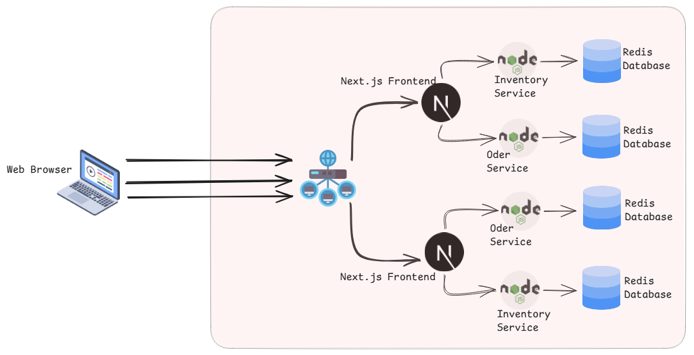

# ⚡ GREENFLASH | Cloud-Native Microservices Platform

A portfolio-grade, high-velocity e-commerce flash sale platform designed to handle real-time inventory deductions and secure order processing. This project demonstrates a decoupled microservices architecture, containerized with Docker, and orchestrated via K3s Kubernetes on a remote Linux VPS.

## 🚀 Core Features
* **Decoupled Architecture:** Frontend, Inventory, and Order domains are strictly separated, allowing independent scaling.
* **Atomic Transactions:** Utilizes Redis `DECR` operations to prevent race conditions and double-selling during high-concurrency flash sales.
* **Internal Cluster Security:** Databases and backend APIs are isolated on the internal Kubernetes network (`ClusterIP`). Only the frontend is exposed.
* **Native Load Balancing:** K3s built-in Traefik Ingress Controller handles traffic routing on standard HTTP Port 80.
* **Persistent State:** Prisma ORM manages complex relational order data in PostgreSQL, backed by Kubernetes Persistent Volumes (PVs).

---

## 🏗️ Tech Stack & Infrastructure

### Application Layer
* **Frontend:** Next.js (React), Tailwind CSS
* **Inventory Service:** Node.js, Express, Redis Client
* **Order Service:** Node.js, Express, Prisma ORM, PostgreSQL

### DevOps & Infrastructure
* **Containerization:** Docker, multi-stage builds (`node:18-bookworm-slim`)
* **Orchestration:** K3s (Lightweight Kubernetes)
* **Routing:** Traefik Ingress Controller
* **Hosting:** GreenCloud Ubuntu VPS
* **Registry:** Docker Hub

---

## 📂 Repository Structure

flash-sale-platform/
├── frontend-service/       # Next.js UI & client-side rendering
├── inventory-service/      # Atomic Redis stock management
├── order-service/          # PostgreSQL checkout & order persistence
└── k8s/                    # Declarative Kubernetes Manifests
    ├── frontend-deployment.yaml
    ├── inventory-deployment.yaml
    ├── order-deployment.yaml
    ├── postgres-deployment.yaml
    ├── redis-deployment.yaml
    └── ingress.yaml        # Traefik routing rules

---

## 🧠 Engineering Challenges & Solutions
During the deployment of this architecture, several critical infrastructure challenges were resolved:

Prisma & Alpine Linux OpenSSL Incompatibility:

Issue: The order-service entered a CrashLoopBackOff because Prisma's query engine failed to find libssl.so.1.1 in standard Alpine containers.

Solution: Refactored the Dockerfile to use node:18-bookworm-slim (Debian 12), ensuring native OpenSSL 3.x compatibility and stable ORM connections while maintaining a small image footprint.

Kubernetes Internal Networking (Redis ECONNREFUSED):

Issue: Node.js microservices defaulted to localhost:6379 for Redis, causing connection refusals in an isolated pod environment.

Solution: Rewrote the Node.js initialization code to dynamically accept process.env.REDIS_URL and implemented K8s internal DNS routing (redis://redis-service:6379), securely bridging the application pod to the database pod.

---

## 📂 About Developer

Sajith Lakmal
BSc (Hons) IT Undergraduate at University of Moratuwa
Passionate about designing resilient database architectures, provisioning Linux infrastructure, and building scalable full-stack web applications.

Focus Areas: DevOps Engineering, Linux System Administration, Docker Containerization, Cloud Security, and Full-Stack Development (Next.js/React/Go).
Let's Connect: WhatsApp - 0743341562
Contact me on Linkdin: https://www.linkedin.com/in/sajith-lakmal-aaa15b355?utm_source=share_via&utm_content=profile&utm_medium=member_ios
